<p align="center"></p>

# Are LEGO themes real universes? A graph analysis of the LEGO catalog

Graph Analytics project 2026, Albert School.

**Group members:** Enzo, Keira, Amandine

## Question

Do LEGO themes (City, Star Wars, Technic, Friends…) form separate universes,
each with its own parts, or do they all share the same bricks? And has LEGO
become more specialized over time?

Hypothesis tested: since the 2000s and the rise of licensed themes, sets
would use more and more specific parts, so themes would be more separated in
the graph than before.

## Main results

Default graph: sets from 1990 to 2025 with at least 50 parts, Jaccard weight
≥ 0.25. All figures come from `results/` (data from 2026-11-06).

- **The graph:** 9,062 sets and 317,495 edges (density 0.0077, mean degree 70).
  It is not connected: 1,640 components, including 1,462 isolated sets. The
  largest component holds 74% of the sets. Its diameter is 16 and its radius
  8; the mean distance is about 3.8.
- **Communities are not themes.** Louvain finds a partition with modularity
  0.63, against 0.28 for the official themes and ≈ 0 for randomly shuffled
  themes. A split by decade (0.36) structures the graph **better** than the
  themes. The NMI between communities and themes is 0.45 (isolated sets
  excluded). The large communities mix several themes from the same era.
- **Another algorithm** (`communities_comparison.csv`). Label propagation
  gives results close to Louvain: 1,814 communities, modularity 0.58 and
  NMI 0.49 (asynchronous, weighted); 1,805 communities, 0.58 and 0.47
  (semi-synchronous, unweighted). Louvain at resolution 1 (our results): 1,677
  communities, 0.63 and 0.45. When the Louvain resolution goes up
  (0.5 → 4), the NMI rises (0.43 → 0.54) and the modularity drops (0.61 → 0.48),
  but this is mostly because there are more communities: we do not conclude
  that themes are recovered better. The NMI of every algorithm stays between
  0.43 and 0.54.
- **A few themes are real universes.** Share of a theme's links that stay
  inside the theme (`theme_cohesion.csv`): Duplo 0.91, Technic 0.85,
  Mixels 0.81, DOTS 0.81, Brickheadz 0.77. Licensed themes are mostly labels:
  Harry Potter 0.10, Disney 0.07, Super Heroes DC 0.06, Jurassic World 0.03.
  The median is 0.29 over 57 themes.
- **Theme graph** (`theme_graph.gexf`, `figures/theme_graph.png`).
  127 themes, 2,487 links, 7 themes with no link at all (all very small: 2 to 19
  sets, for example Bluey or Scala). The heaviest links go through Star Wars and
  Creator (Creator–Star Wars, Star Wars–Icons) but they say little: their
  `lift` is close to 1 (1.10 and 1.38), which is what one expects from a theme
  with a huge number of links. The pairs most linked compared with chance
  (`lift`, themes with at least 30 sets) are themes close in universe:
  Castle–Pirates (56), Pirates–Adventurers (45), Train–Town (20),
  Bionicle–Hero Factory (15).
- **Guessing a set's theme from its neighbors** (`theme_prediction.csv`).
  Each neighbor votes for its theme: the guess is right for **63.9%** of
  connected sets (7,600 sets) and 53.6% when isolated sets count as failures,
  against 8.4% by always predicting Star Wars and 3.1% at random. Best guessed:
  Technic 100%, Town 93%, Duplo 88%, Star Wars 86%, Friends 83%.
  Worst guessed are label themes, almost always confused with Star Wars:
  LEGO Ideas 0%, Icons 5%, LEGO Exclusive 5%, Monkie Kid 9%. This matches the
  cohesion results: closed universes can be guessed, labels cannot.
- **Null model** (`theme_cohesion_null.csv`, `null_model_runs.csv`). If parts
  are shuffled between sets (set sizes and part frequencies kept, 10 draws),
  only about 180 pairs of sets reach the 0.25 threshold, against 317,495 in
  reality. At equal density, the modularity of themes falls to 0.005 (against
  0.28) and **all 57 themes are more cohesive than in each of the 10 draws**.
  This qualifies the previous point: licensed themes are still 2 to 4 times
  more cohesive than chance (Harry Potter 3.9, Disney 2.2, Super Heroes DC 2.1,
  Jurassic World 2.6). They are weak universes rather than mere labels. Themes
  with their own part system are far ahead (Technic 18, Duplo 11). Median
  ratio: 19.
- **Parts:** 77% of the 28,856 parts appear in only one theme, and 51 parts
  appear in 100 themes or more (`figures/parts_themes.png`). The "signature"
  parts (`signature_parts.csv`) are mechanical parts for Technic, a different
  scale for Duplo, dedicated molds for Super Mario and printed parts for Star
  Wars and Friends.
- **Evolution:** the hypothesis is not confirmed. The share of a set's parts
  that are exclusive to its theme goes from 8.9% (1990s) to 4.4% (2010s and
  2020s). This result does not depend on the threshold and holds under the
  other parameters (minimum size, color, excluded themes). The drop in theme
  modularity by decade (0.52 → 0.17), however, **depends on the threshold**:
  at 0.35 it goes back up (0.54 → 0.47 → 0.67 → 0.62,
  `temporal_robustness.csv`). It should therefore not be presented as a trend.
- **Robustness of the evolution** (`temporal_robustness.csv`,
  `figures/temporal_robustness.png`). Without stickers, the share of exclusive
  parts goes from 8.3% to 4.0%: stickers do not explain the drop. In count,
  the drop is smaller and not steady: 4.6 exclusive parts per set in the
  1990s, 2.9 in the 2010s and 3.8 in the 2020s. Over the same period, sets go
  from 57 to 103 distinct parts on average. The share therefore drops mostly
  because sets grow with parts shared across themes.

| Period | Theme modularity (threshold 0.25) | Theme modularity (threshold 0.35) | NMI (no isolated sets) | Theme-exclusive parts | Exclusive parts per set |
|---|---|---|---|---|---|
| 1990–1999 | 0.52 | 0.54 | 0.70 | 8.9% | 4.6 |
| 2000–2009 | 0.31 | 0.47 | 0.52 | 9.0% | 4.2 |
| 2010–2019 | 0.32 | 0.67 | 0.45 | 4.4% | 2.9 |
| 2020–2025 | 0.17 | 0.62 | 0.42 | 4.4% | 3.8 |

These results agree with Bartneck and Moltchanova (2018), who show on
BrickLink data from 1955–2015 that new parts are reused less and less.

The set graph in Gephi, colored by Louvain community
(`figures/gephi_communities.png`) and then by root theme
(`figures/gephi_root_themes.png`), with the same layout.

## Data

- **Source:** the Rebrickable database, CSV downloads
  (<https://rebrickable.com/downloads/>). Rebrickable is a community database
  of the LEGO catalog (sets, parts, inventories, themes).
- **Tables used:** `themes`, `sets`, `inventories`, `inventory_parts`,
  `parts`, `part_categories`.
- **Download date:** 2026-11-06 (`data/raw/DOWNLOAD_DATE.txt`). The files are
  updated continuously, so the figures depend on the date.
- **Terms of use:** according to Rebrickable's terms
  (<https://rebrickable.com/terms/>, section 5), catalog data may be used "for
  any purpose", through the API or the Downloads page, and automated
  downloading is only allowed from that page (which is what `download_data.py`
  does). Rebrickable asks that the source be cited: **data from Rebrickable**.
  LEGO® is a trademark of the LEGO Group, which does not sponsor or endorse
  this project.
- See [`data/README.md`](data/README.md) for the download.

## Code reuse and AI tools

- **Existing code:** no code from an existing analysis of this data was
  reused. The project uses the NetworkX, pandas, NumPy, SciPy, scikit-learn
  and matplotlib libraries.
- **AI tools:** the code (loading, graph construction, analysis functions,
  tests) and the search for existing studies were done with the help of
  Claude Code (Anthropic).

## Graph model

1. **Bipartite set–part graph.** A set is linked to each part it contains
   (spare parts excluded; for a set with several inventory versions, the first
   one is kept).
2. **Projection onto sets.** Two sets are linked if they share parts. The
   resulting graph is **undirected**, **simple** (no multiple edges or loops)
   and **weighted**.

Modeling choices, all adjustable (`lego_graph/config.py` or options of
`run_analysis.py`):

| Choice | Default | Option |
|---|---|---|
| Period | 1990–2025 | `--year-min`, `--year-max` |
| Minimum set size | 50 parts | `--min-parts` |
| Excluded themes | Gear, Books, Key Chain, Bulk Bricks, Service Packs, Supplemental, Collectible Minifigures | `exclude_themes` in `config.py` |
| One part = | one shape (`part_num`), all colors combined | `--with-color` |
| Very frequent parts | kept | `--max-part-share 0.2` removes them |
| Stickers ("Stickers" category) | kept | `--drop-stickers` removes them |
| Edge weight | Jaccard = shared parts / parts in either set | `--weighting count\|jaccard\|idf` |
| Threshold | edge kept if weight ≥ 0.25 | `--min-weight` |
| k-nearest-neighbor backbone | off | `--top-k` |

Minifigures are not counted: their parts are in separate inventories.

**Why 0.25?** Below about 0.15, almost every pair of sets is linked (more than
5 million edges) and the graph no longer says anything. The table
`results/sensitivity.csv` (produced by `sensitivity.py`) shows connectivity
and communities for thresholds from 0.15 to 0.4.
`results/sensitivity_coarse.csv` is an earlier, wider sweep made with an old
grid of `sensitivity.py`: the current script does not regenerate it.

## Installation

The project uses [uv](https://docs.astral.sh/uv/). Dependencies are in
`pyproject.toml` and their exact versions are pinned in `uv.lock`.

```bash
uv sync
```

## Running

Download the data (already in `data/raw/`; otherwise see `data/README.md`):

```bash
uv run python download_data.py
```

Full analysis with default parameters (about 3 min 30 s):

```bash
uv run python run_analysis.py
```

Sensitivity study for the threshold and the weighting:

```bash
uv run python sensitivity.py
```

Null model for theme cohesion (10 null graphs, about 2 min):

```bash
uv run python null_model.py
```

Robustness of the evolution by period, at thresholds 0.25 and 0.35, with and
without stickers (under a minute):

```bash
uv run python temporal_robustness.py
```

Additional analyses (another community algorithm, theme graph, theme guessed
from neighbors):

```bash
uv run python run_extensions.py
uv run python run_extensions.py --n-seeds 3   # stability across seeds
```

Example with other parameters:

```bash
uv run python run_analysis.py --weighting idf --min-weight 120 --resolution 1.2
```

To test without the real data (synthetic dataset, meaningless results), then
run the tests:

```bash
uv run python run_analysis.py --demo --min-parts 1 --year-min 1980 --min-weight 0.05
uv run python null_model.py --demo
uv run python temporal_robustness.py --demo
uv run python run_extensions.py --demo
uv run pytest
```

## Output files

| Content | File |
|---|---|
| Number of nodes and edges, density, clustering | `results/summary.json` → `basic` |
| Connectivity, components | `summary.json` → `connectivity`, `results/components.csv` |
| Diameter, radius, mean distance (largest component) | `summary.json` → `distances` |
| Centralities (degree, weighted degree, betweenness, eigenvector) | `results/centralities.csv`, `summary.json` → `top_sets` |
| Universal parts (degree in the bipartite graph) | `results/parts_universality.csv`, `figures/parts_themes.png` |
| Signature parts of each theme | `results/signature_parts.csv` |
| Louvain communities compared with themes (modularity, NMI, ARI) | `summary.json` → `communities`, `results/communities_summary.csv`, `results/communities_assignment.csv`, `figures/communities_vs_themes.png` |
| Louvain at several resolutions and label propagation, compared with themes (modularity, NMI, ARI) | `results/communities_comparison.csv` (`run_extensions.py`) |
| Cohesion of each theme | `results/theme_cohesion.csv` |
| Cohesion of each theme compared with the null model | `results/theme_cohesion_null.csv`, `results/null_model_runs.csv` (`null_model.py`) |
| Theme graph (one node per root theme) | `results/theme_graph.gexf`, `results/theme_graph_edges.csv`, `figures/theme_graph.png` (`run_extensions.py`) |
| Theme guessed by neighbor vote, success per theme | `results/theme_prediction.csv`, `results/theme_prediction_sets.csv`, `results/extensions_summary.json` (`run_extensions.py`) |
| Evolution by decade | `results/temporal.csv`, `figures/temporal.png` |
| Evolution by decade at thresholds 0.25 and 0.35, with and without stickers | `results/temporal_robustness.csv`, `figures/temporal_robustness.png` (`temporal_robustness.py`) |
| Degree distribution | `figures/degree_distribution.png` |
| Threshold sensitivity | `results/sensitivity.csv` |
| Graph for Gephi (with communities) | `results/lego_sets.gexf` (≈ 80 MB, not versioned: rerun `run_analysis.py`) |
| Gephi images of the set graph, colored by community and by theme | `figures/gephi_communities.png`, `figures/gephi_root_themes.png` |
| Presentation slides (standalone HTML, arrow keys to advance, F for full screen; 10-page PDF) | `slides/deck.html`, `slides/deck.pdf` (regenerate the HTML from `results/`: `uv run python slides/build.py`) |

## Methods and conventions

- **Diameter and radius**: computed exactly on the largest connected
  component, with NetworkX `usebounds=True` (Takes and Kosters, 2011).
  Distance is the number of edges (unweighted). The mean distance is
  estimated from 200 randomly drawn sources.
- **Clustering**: mean of the weighted clustering of Onnela et al. (2005),
  computed with sparse matrices (same value as NetworkX, tested).
- **Betweenness**: edge distance = 1 / weight (a strong link brings two sets
  closer). It is estimated on 500 randomly drawn sources (`--betweenness-k`).
- **Eigenvector**: computed on the largest component, weighted.
- **Communities**: weighted Louvain (Blondel et al., 2008), seed 42. The
  partition found is compared with the root themes using NMI and ARI, also
  computed without isolated sets (each forms its own community, which inflates
  the NMI). Theme modularity is compared with two baselines: randomly shuffled
  themes (same sizes) and a split by decade.
- **Another algorithm** (`run_extensions.py`): Louvain at resolutions 0.5,
  1, 2 and 4, and label propagation (Raghavan et al., 2007) in two versions:
  asynchronous weighted with a fixed seed, and semi-synchronous unweighted,
  deterministic. Modularity is always computed at resolution 1 so rows stay
  comparable. A higher resolution gives more communities, which alone can
  raise the NMI: the `n_communities` column helps read it. The "thèmes
  officiels" (official themes) row is a reference (NMI = 1 by definition).
- **Theme cohesion**: `internal_share` = 2 × weight of internal edges /
  sum of the weighted degrees of the theme's sets. 1 = closed universe.
  `expected_share` is the expected value if links ignored themes.
- **Theme graph**: one node per root theme. Edge weight = sum of the Jaccard
  weights of the edges between sets of the two themes; `n_links` = number of
  those edges; `lift` = this weight divided by the weight expected if links
  ignored themes (volume_a × volume_b / total volume, as in modularity). The
  figure keeps only themes with at least 30 sets and, for each, its 3
  strongest links.
- **Guessed theme**: each neighbor votes for its root theme with the edge
  weight (`accuracy_unweighted`: one neighbor = one vote). The set's own theme
  is not used. `accuracy` is computed on non-isolated sets, `accuracy_all`
  counts isolated sets as failures. Baselines: always predicting the most
  frequent theme, and drawing at random according to theme frequencies (sum
  of p²).
- **Signature parts**: `specificity` = share of the sets containing the part
  that belong to the theme; `coverage` = share of the theme's sets that
  contain it.
- **Specialization**: `exclusive_part_share` is the mean share of a set's
  parts that appear in no other root theme of the 1990–2025 catalog. It does
  not depend on the projection threshold. `exclusive_parts_per_set` gives the
  same indicator as a number of parts, and `parts_per_set` the mean number of
  distinct parts per set: a share can drop just because sets grow.
- **Null model** (`null_model.py`): the set × part matrix is shuffled with the
  *curveball* algorithm (Strona et al., 2014), 20 rounds per graph. Each set
  keeps exactly its number of parts and each part its number of sets; only the
  link between parts and themes is broken. The projection is redone 10 times
  (seeds 42 to 51). At threshold 0.25, a null graph has almost no edges: we
  therefore keep its strongest edges, as many as in the real graph (same
  density), then compute the same cohesion as for the real graph.
  `theme_cohesion_null.csv` gives, per theme, the random mean and standard
  deviation (`null_mean`, `null_std`), the ratio `ratio_to_null`, the
  `z_score` and an empirical p-value (1 + draws at least as cohesive) /
  (1 + draws). With 10 draws, the smallest possible p-value is 1/11 ≈ 0.09:
  we therefore rely on the number of themes above every draw
  (`n_null_ge_real` = 0) and on the ratio. The `z_score` is only indicative:
  with 10 draws and a standard deviation estimated on 10 values, it reaches
  huge values (up to 405) that do not read as a probability. The ratio is also
  inflated when random cohesion is almost zero (Belville 225).
- **Stickers**: `--drop-stickers` removes parts in the Rebrickable "Stickers"
  category before building the graph.
- **Gephi images**: `results/lego_sets.gexf` opened in Gephi, isolated sets
  removed (*Degree Range* filter ≥ 1), ForceAtlas2 layout (LinLog,
  approximate repulsion), colored by the `community` partition and then by
  `root_theme`.

## Limitations

- The threshold changes the graph a lot: only results that hold across
  several thresholds are presented as conclusions.
- A printed part has its own number and a sticker sheet counts as a part:
  both inflate exclusive parts. Stickers can be removed (`--drop-stickers`)
  and change the results little; printed parts are still counted separately.
- The null model has only 10 draws: the empirical p-value cannot go below
  1/11. The null graph is compared at equal density (same number of edges)
  rather than at the same threshold, where it would be almost empty.
- The modularity of a projection ignores part of the bipartite structure
  (Barber, 2007).
- Asynchronous label propagation depends on the order in which nodes are
  visited: the partition can change from one seed to another (`--n-seeds`).

## References

- Bartneck, C. and Moltchanova, E. (2018). Expanding the LEGO universe:
  exponential growth of LEGO parts. *PLOS ONE*.
- Blondel, V. et al. (2008). Fast unfolding of communities in large networks.
  *J. Stat. Mech.*
- Raghavan, U. N., Albert, R. and Kumara, S. (2007). Near linear time algorithm
  to detect community structures in large-scale networks. *Physical Review E*.
- Onnela, J.-P. et al. (2005). Intensity and coherence of motifs in weighted
  complex networks. *Physical Review E*.
- Takes, F. and Kosters, W. (2011). Determining the diameter of small world
  networks. *CIKM*.
- Barber, M. (2007). Modularity and community detection in bipartite networks.
  *Physical Review E*.
- Strona, G., Nappo, D., Boccacci, F., Fattorini, S. and San-Miguel-Ayanz, J.
  (2014). A fast and unbiased procedure to randomize ecological binary
  matrices with fixed row and column totals. *Nature Communications*.

## Reproducibility

Every random step uses a fixed seed (`--seed`, 42 by default). Louvain results
can vary between NetworkX versions: `uv.lock` pins the exact versions, so
`uv sync` reinstalls the same ones. Even with the same versions, Louvain can
change from one machine to another when two choices are nearly tied (rounding
differences at the fifteenth digit). With the same code, a second machine got
an NMI of 0.52 instead of 0.53 for 2000–2009 (Louvain modularity 0.6692
instead of 0.6693); the other periods and the full graph are identical. The
table above uses the value from `results/temporal.csv`.

## Structure

```
lego_graph/
  config.py     modeling parameters
  load.py       reading the Rebrickable CSVs
  build.py      set–part bipartite graph and weighted projection
  analysis.py   measures (connectivity, distances, centralities, parts, communities, time)
  null_model.py null model (curveball shuffle) and cohesion compared with chance
  extensions.py another community algorithm, theme graph, guessed theme
  figures.py    report figures
  synthetic.py  synthetic dataset for the tests
download_data.py
run_analysis.py
sensitivity.py
null_model.py           null model for theme cohesion
temporal_robustness.py  evolution by period depending on threshold and stickers
run_extensions.py       label propagation, theme graph, guessed theme
tests/          pipeline tests (pytest)
assets/         README image
data/raw/       downloaded data
results/        tables and summary produced
figures/        figures produced
slides/         presentation slides: build.py fills template.html with the figures from results/
pyproject.toml  dependencies (uv)
uv.lock         exact dependency versions
```
